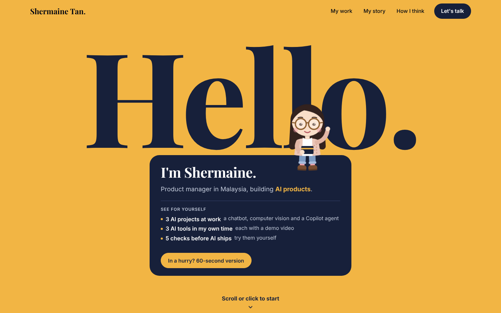

# Shermaine Tan: Portfolio

My personal portfolio. I am a product manager in Malaysia, building AI products.

**Live site:** [huuyin.github.io/shermaine](https://huuyin.github.io/shermaine/)

## What is on it

- **My work:** three AI tools I built in my own time, each with a short demo, then 14 projects from my day jobs.
- **My story:** six chapters, from a law degree to AI.
- **How I think:** two short activities, one on product decisions and one on AI.
- **Contact:** email, LinkedIn and my CV.

## How it is built

A single page with no server behind it, hosted on GitHub Pages.

- The site itself is `index.html` with `assets/`, `fonts/` and `images/`.
- `source/` holds the page sources and a small build script. See [source/README.md](source/README.md) for how to change the site.
- The demo videos are in `videos/`.

## Earlier version

The previous version of this portfolio is kept at [huuyin.github.io/portfolio-v1](https://huuyin.github.io/portfolio-v1/).
